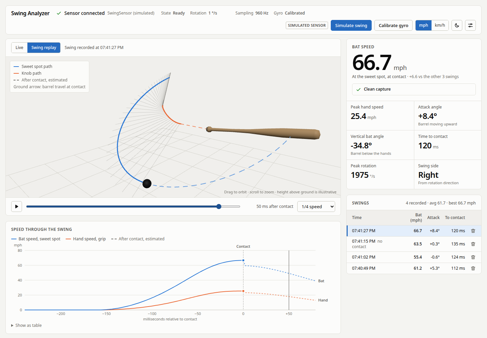

# Baseball Swing Analyzer

A bat-knob motion sensor and a laptop app that shows bat speed, swing path and a
live 3D view of the bat.



*The laptop dashboard replaying a swing (simulated sensor): 3D bat view, bat speed at the sweet spot, and the speed chart through contact.*

```
Baseball_Swing_Analyzer/   firmware for the sensor (Arduino sketch)
app/server/                laptop server: Bluetooth link, swing maths, storage
app/web/                   dashboard (React, Tailwind v4, three.js)
app/tests/                 server tests
```

## Hardware

| Part | Notes |
|---|---|
| Seeed XIAO ESP32-C3 | microcontroller + Bluetooth |
| ST STEVAL-MKI251A adapter board | carries the LSM6DSV320X: gyro ±4000 °/s, accelerometers ±16 g and high-g (set to ±128 g) |
| Carrier board (perfboard cut to the knob, or a custom PCB) | holds the adapter and the XIAO rigidly together |
| 2 × 10 kΩ resistors | I2C pull-ups, only if the adapter has none fitted (check its schematic) |
| 3.7 V LiPo, 100–150 mAh | to the XIAO's BAT+ / BAT− pads, slide switch in the + lead |

Wiring, using the pin names from ST's data brief for the adapter (find each
one's position on the 24-pin header in that document before soldering):

| Adapter pin | Connect to |
|---|---|
| VDD and VDDIO | XIAO 3V3 |
| GND | XIAO GND |
| SDA | XIAO D4 |
| SCL | XIAO D5 |
| CS | 3V3 (selects I2C) |
| SDO | GND (the firmware also accepts 3V3) |

If the adapter has no pull-ups, fit one 10 kΩ resistor from SDA to 3V3 and one
from SCL to 3V3. Leave the remaining adapter pins unconnected.

Solder the adapter and the XIAO to the carrier board with the sensor chip over
the centre of the board, so the chip's Z axis runs along the bat once mounted.
With the chip facing away from the bat, leave "Sensor chip faces away from the
bat" ticked in the app's settings.

`mount/knob_mount.scad` (OpenSCAD) is a removable knob mount that needs no
changes to the bat: a rigid pod (PETG or PLA) screwed shut over the carrier
board and battery, held against the knob's end face by a stretchy TPU sleeve.
One pod fits every bat; print a sleeve for each knob size. Set the carrier
board and battery sizes in the file before printing the pod. If the carrier
board is too large, rendering stops with a message saying what to change.

## Firmware

Open `Baseball_Swing_Analyzer/Baseball_Swing_Analyzer.ino` in the Arduino IDE,
pick the board **XIAO_ESP32C3** (ESP32 core 3.3 or newer) and upload. No extra
libraries are needed.

The serial monitor (115200 baud) prints a status line every five seconds: sample
rate, FIFO overruns, gyro bias and Bluetooth state. If it ever reports FIFO tag
errors, set `FIFO_WORDS_PER_READ` to 1 in `Config.h`.

The gyro calibrates itself whenever the bat rests still for half a second.

## Laptop app

One-time setup, from the `app` folder:

```
python -m venv .venv
.venv\Scripts\python -m pip install -r server\requirements.txt
cd web
npm install
npm run build
```

Run it, from the `app` folder:

```
.venv\Scripts\python -m server
```

Then open http://127.0.0.1:8000. The server finds the sensor over Bluetooth by
itself and reconnects if it drops.

Without the hardware, run a simulated sensor instead:

```
.venv\Scripts\python -m server --simulate
```

Swings and settings are kept in `app/data`. Each swing stores the raw capture, so
changing the bat length in settings re-analyses every stored swing.

## Tests

From the `app` folder:

```
.venv\Scripts\python -m pytest tests
```

The tests build swings from a known motion model, pass them through a model of
the sensor and the same packet framing the firmware uses, and check the
reconstructed numbers against the true ones.

## How a swing is measured

1. The sensor samples at 960 Hz and keeps the last couple of seconds in memory.
2. A swing starts when rotation across the bat passes the start threshold and
   counts if it reaches the minimum peak. A ball strike is recognised as a
   sudden step in acceleration or rotation.
3. The sensor sends a short summary straight away, then the raw samples from
   0.75 s before the swing to 0.15 s after contact.
4. Where the 16 g accelerometer runs out of range, the laptop switches to the
   chip's high-g accelerometer, after measuring that channel's zero offset from
   the part of the swing both can read.
5. The laptop integrates the gyro for the bat's orientation and the
   accelerometer for the knob's motion, starting from the stillest moment before
   the swing. Bat speed is the speed of the sweet spot at contact.

## Known limits

- Bat speed is an estimate until it has been compared against a radar or a
  commercial sensor on real swings.
- Acceleration is measured up to 128 g. Swings that go past the limit are
  marked "Reduced confidence". The high-g accelerometer is coarser than the
  16 g one, so it is only used where the 16 g one is out of range.
- The firmware has not yet run on a real LSM6DSV320X. Register settings follow
  ST's driver, but the sensor's behaviour is unconfirmed until first power-up.
- The path after contact is an estimate: the strike saturates the accelerometer.
- Height above the ground is not measured; the 3D view draws the hands at a
  typical height.
- There is no battery level reading and no sleep mode; switch the sensor off
  after a session.
